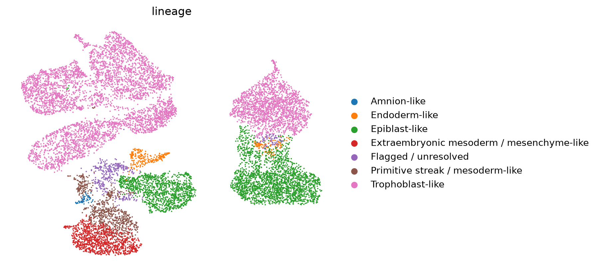
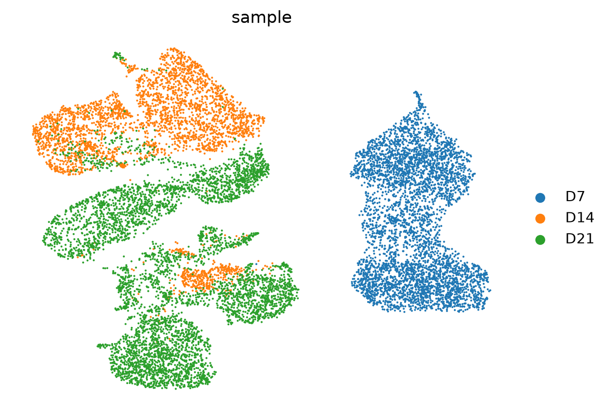
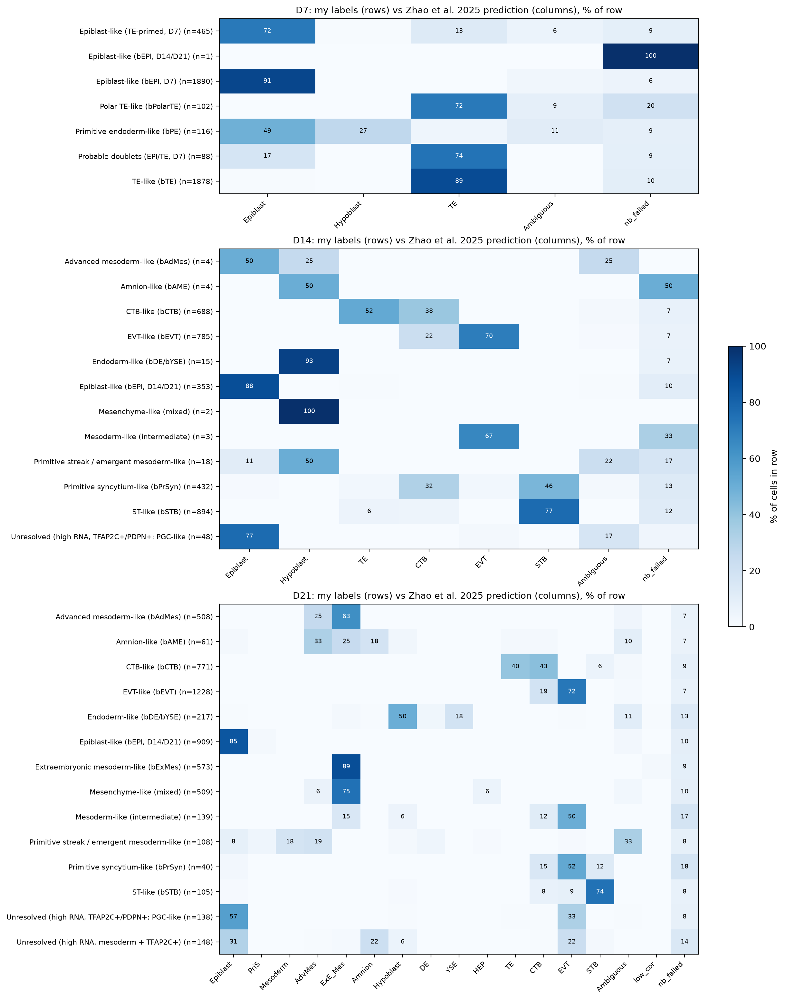

# Single-cell RNA-seq re-analysis of human blastoids cultured to day 21 (GSE226794)

A portfolio project in which I re-analyse a public single-cell RNA-seq dataset of 3D-cultured human blastoids
(days 7, 14 and 21) to practise a complete workflow in Python (Scanpy) and R. The data and the biological questions
come from the original study (Karvas et al.); the analysis choices, thresholds and any errors here are my own.
This is a learning project based on public data, not original experimental work.

> **Status:** complete: Python workflow (cell calling, QC, clustering, annotation, trajectories), R pathway analysis
> (GO enrichment) and comparison of the annotation with a published human embryo reference tool.

## Data

- **Source:** GEO accession [GSE226794](https://www.ncbi.nlm.nih.gov/geo/query/acc.cgi?acc=GSE226794).
- **Original study:** Karvas RM, et al. *3D-cultured blastoids model human embryogenesis from pre-implantation to early
  gastrulation stages.* Cell Stem Cell 30, 1148-1165 (2023). https://doi.org/10.1016/j.stem.2023.08.005
- **Samples used:** D7 = GSM7083828, D14 = GSM7083829, D21 = GSM7677371 (10x Genomics 3' v3).
- **Raw data are not stored in this repository** (file size). Download `GSE226794_RAW.tar` from the GEO page and
  extract it into `data/raw/`. Downloading by command line (requests/curl/FTP) returned errors or truncated files in my
  hands, so the archive was downloaded manually in the browser and every `.gz` file was integrity-checked.
- The D7 and D14 matrices are **raw (unfiltered)** and contain about 2.2 and 2.7 million barcodes, whereas the D21
  matrix is **pre-filtered** (6,833 barcodes). Cell calling was therefore needed for D7 and D14.

## Repository structure

```
Notebook/   Jupyter notebooks, one per analysis stage (01-09)
R/          R scripts (pathway enrichment)
Figure/     figures used in this README and in the notebooks
Result/     small result tables (CSV); large intermediate files are not tracked
environment.yml   conda environment, main packages (Python 3.11, Scanpy 1.11.5)
environment_full_windows.yml   complete export of the environment used (Windows)
```

## Workflow

| Notebook | Purpose | Main outputs |
|---|---|---|
| `02_real_data_loading` | Verify the downloaded files, first read of D7 | file checks |
| `03_load_and_cell_calling` | Barcode rank plots and per-sample cell calling | `Figure/*_barcode_rank.png` |
| `04_qc_metrics` | QC metrics, thresholds, filtering | `Result/qc_filtering_summary.csv` |
| `05_doublet_detection` | Scrublet per sample | `Result/scrublet_scores.csv` |
| `06_merge_normalize_hvg` | Merge, normalise, select variable genes | - |
| `07_pca_umap` | PCA, neighbours, UMAP (no batch correction) | `Figure/umap_unintegrated_qc.png` |
| `08_clustering_markers` | Leiden clustering, marker genes, annotation | `Result/markers_leiden_r05_top50.csv`, `Result/cell_state_v3_labels.csv` |
| `09_trajectory` | PAGA and diffusion pseudotime per sample | `Figure/D7_*`, `Figure/D14_troph_*`, `Figure/D21_embryonic_*` |
| `10_embryo_reference_benchmark` | Export raw counts per sample; compare my labels with predictions from the human embryo reference tool of Zhao et al. (2025) | `Result/embryo_ref/agreement_by_*.csv`, `Figure/embryo_ref_crosstab_v3.png` |
| `R/01_pathway_enrichment.R` | GO enrichment per cluster (clusterProfiler) | `Result/go_bp_by_cluster.csv`, `Result/go_bp_by_cluster_no_ribosomal.csv`, `Figure/go_bp_dotplot.png` |

### Key analysis choices

- **Cell calling (D7, D14):** thresholds chosen from the barcode rank plots and UMI histograms: D7 >= 1,000 UMI
  (5,977 barcodes); D14 >= 5,000 UMI (3,996 barcodes) because its ambient-RNA plateau is much higher.
  D21 was already filtered (minimum 500 UMI) and was kept as is.
- **QC filtering:** < 20% mitochondrial counts and >= 1,500 detected genes, giving 4,540 (D7), 3,246 (D14) and
  5,454 (D21) cells; 13,240 cells in total.
- **Doublets:** Scrublet was run per sample; its automatic threshold called no doublets, but its score distribution was
  not bimodal, so this is not evidence of absence. Cells with high scores were examined during annotation (below).
- **Normalisation and embedding:** library-size normalisation to 10,000 counts, log1p, 3,000 variable genes selected
  within each sample, 20 principal components, 15 neighbours, Leiden clustering at resolution 0.5 (14 clusters).
- **No batch correction:** each timepoint is one sample, so timepoint is confounded with culture condition and
  processing; integration could remove real biology.

## Results




*Unintegrated UMAP of 13,240 cells. Top: broad lineages assigned from marker genes. Bottom: sample of origin.*

### Broad lineages (13,240 cells)

| Lineage | Cells |
|---|---|
| Trophoblast-like | 6,923 |
| Epiblast-like | 3,618 |
| Extraembryonic mesoderm / mesenchyme-like | 1,084 |
| Primitive streak / mesoderm-like | 780 |
| Flagged / unresolved | 422 |
| Endoderm-like | 348 |
| Amnion-like | 65 |

### Composition by sample (% of cells; descriptive only, one sample per timepoint)

| Lineage | D7 | D14 | D21 |
|---|---|---|---|
| Epiblast-like | 51.8 | 10.9 | 16.7 |
| Trophoblast-like | 43.6 | 86.2 | 39.2 |
| Endoderm-like | 2.6 | 0.5 | 4.0 |
| Primitive streak / mesoderm-like | 0.0 | 0.8 | 13.8 |
| Extraembryonic mesoderm / mesenchyme-like | 0.0 | 0.1 | 19.8 |
| Amnion-like | 0.0 | 0.1 | 1.1 |
| Flagged / unresolved | 1.9 | 1.5 | 5.2 |

Detailed labels (for example CTB-, EVT- and syncytium-like states) are in `Result/cell_state_v3_composition.csv`.

### Annotation

Cell states were assigned from canonical markers and the top marker genes of each cluster, then compared with the
populations described in the original study (D7: epiblast, primitive endoderm, trophectoderm, polar trophectoderm;
D14: epiblast, primitive endoderm, cytotrophoblast, extravillous trophoblast, syncytiotrophoblast, primitive syncytium;
D21: gastrulation-stage populations). Two clusters initially labelled "transitional" were sub-clustered: D7 cluster 2
contained a primitive-endoderm-like group and a group of 88 probable doublets (about twice the UMI of neighbouring
clusters, high doublet score, combined epiblast/TE markers); D21 cluster 9 contained primitive-streak-like,
amnion-like and mesoderm-like cells. In total 422 cells (3.2%) are flagged (probable doublets or unresolved
high-RNA groups); they stay in the data and are excluded only from the main trajectory analyses.

### Trajectories (PAGA and diffusion pseudotime; hypotheses only)

| Sample | Cells used | Result | Robustness (Spearman, alternative PCs/roots) |
|---|---|---|---|
| D7 | 4,451 | Epiblast -> TE -> polar TE and an epiblast -> primitive-endoderm branch; POU5F1 falls, GATA3 rises, CDX2 peaks before NR2F2/CGA | 0.90-0.999 |
| D14 trophoblast | 2,799 | EVT-like - CTB-like - primitive-syncytium-like - ST-like chain; ASCL2, HLA-G, ITGA5, MMP2 rise along the EVT branch; CYP19A1 peaks before ERVW-1 | 0.97-0.997 |
| D21 embryonic side | 1,942 | Epiblast connects only to primitive-streak-like cells, which connect to endoderm-, amnion- and mesoderm-like states | 0.87-0.97 |

These results are consistent with relationships reported in the original study, but pseudotime from a single snapshot
does not prove lineage direction (the direction is set by the chosen root cell).

### Pathway analysis (R, clusterProfiler)

GO Biological Process over-representation analysis was run for the top 200 marker genes of each Leiden cluster
(adjusted p < 0.05, log2 fold change > 0.5, detected in > 25% of the cells of the cluster; background = all genes
tested for markers). Figure: `Figure/go_bp_dotplot.png`; full table: `Result/go_bp_by_cluster.csv`.

- Terms were consistent with the annotation of several clusters: cell migration, angiogenesis and extracellular matrix
  organisation in the EVT-like clusters of both D14 and D21; pregnancy-related terms in the syncytium-like D14 cluster;
  lipoprotein particle assembly in the D21 endoderm-like cluster; mesenchyme development and extracellular matrix
  organisation in the mesoderm-like D21 clusters.
- Trophoblast states are poorly covered by GO: the primitive-syncytium-like D14 cluster had no significant term and
  the CTB-like D14 cluster had three.
- "Cytoplasmic translation" terms (clusters 0, 2 and 11) consisted of ribosomal protein genes. The median ribosomal
  fraction was highest in cluster 11 (36%) and lowest in the D14 syncytium-like clusters (17-21%), and D14 as a whole
  has a lower ribosomal fraction than D7 and D21, so these terms are not interpreted. After removing RPS/RPL genes the
  number of enriched terms fell from 37 to 6 (cluster 11), from 49 to 29 (cluster 0) and from 67 to 49 (cluster 2),
  while other clusters were largely unchanged (`Result/go_bp_by_cluster_no_ribosomal.csv`).
- The oxidative-phosphorylation term in D7 epiblast-like cells was driven mainly by nuclear-encoded respiratory-chain
  genes (8 of 10 genes), not by mitochondrial-encoded genes.
- Broad "axon development" terms are not interpreted as neural differentiation: the original study reports no neural
  induction at D21.

### Comparison with a human embryo reference (Zhao et al. 2025)

My labels were compared with an independent prediction from the early embryogenesis prediction tool of Zhao et al.
(2025), which projects query cells onto an integrated human embryo reference (zygote to gastrula). The raw counts of each
sample were uploaded separately to the web tool (v2.1.2; neighbourhood calculation on; no cell-group file, so my labels
were not used by the tool). For D7, 3,659 of the 4,000 reference variable genes were present in the data.
Predictions and comparison tables: `Result/embryo_ref/`; figure: `Figure/embryo_ref_crosstab_v3.png`.



*Rows: my labels (number of cells); columns: label predicted by the reference tool; values: % of the cells in each row
(values below 5% not printed). Groups with fewer than 20 cells in a sample are shown but not interpreted.*

A cell counts as a match when the predicted label is in a set I defined for each of my labels (for example, CTB-like =
CTB or TE; mesoderm-type labels = AdvMes, ExE_Mes or Mesoderm; full rules in Notebook 10). Flagged cells were not
evaluated, and cells without a clear prediction (nb_failed, Ambiguous, low_cor; about 8-15% per label) were excluded
from the percentages and reported separately.

| Sample | Cells evaluated | Agreement |
|---|---|---|
| D7 | 3,971 | 96.7% |
| D14 | 2,854 | 83.7% |
| D21 | 4,536 | 87.9% |

- **Supported (>= 90% of assigned cells):** D7 epiblast-like (100%), TE-like (99.4%) and polar TE-like (100%; the
  reference has no separate polar TE class); epiblast-like in D14 and D21 (99.0%, 97.2%); CTB-like in D14 and D21
  (99.7%, 92.7%; predicted as CTB or TE); endoderm-like in D14 and D21 (100%, 95.1%); D21 mesoderm-type labels at the
  lineage level (bAdMes 98.9%, bExMes 100%, mixed mesenchyme 92.8%).
- **Partly supported:** EVT-like (75.7%, 79.4%) and ST-like (87.5%, 80.4%) in D14 and D21.
- **Weak or not supported:**
  - D7 primitive-endoderm-like (116 cells): 33.3%, most cells predicted as epiblast. Small groups may not form their
    own neighbourhoods, a limitation also noted by Zhao et al.
  - D14 primitive-syncytium-like: 54.6% STB, most of the rest CTB; the reference has no primitive syncytium class.
    The 40 D21 primitive-syncytium-like cells matched in only 15.2%.
  - D21 intermediate-mesoderm-like (139 cells): 18.3%; about half were predicted as EVT, so this label is not supported
    and the group may contain trophoblast cells.
  - D21 amnion-like (61 cells): 21.6%. Zhao et al. also could not resolve the few amnion cells of this dataset.
  - D21 primitive-streak-like (108 cells): 41.7% without a clear prediction and only 4.6% predicted as PriS; the 71.4%
    agreement depends on the broad matching rule.
  - Mesoderm subtypes: most cells of all three D21 mesoderm labels were predicted as ExE_Mes (bExMes 88.7%, mixed
    mesenchyme 74.9%, bAdMes 63.4% versus 25.0% AdvMes), so my split into advanced and extraembryonic mesoderm is
    only weakly supported.
- Flagged groups were split across several reference lineages (for example, D7 probable doublets: 74% TE, 17%
  epiblast), which is consistent with flagging them.

The agreement values depend on my matching rules, some states in my annotation have no counterpart in the reference,
and the tool predicts labels at the level of neighbourhoods. This is a computational comparison, not experimental
validation.

## Limitations

- **One sample per timepoint, no replicates.** Cell-state proportions are descriptive and were not tested
  statistically. Differences between timepoints are confounded with culture condition (D7 suspension, D14/D21 3D matrix)
  and processing batch; no batch correction was applied. The same lineage (for example CTB-like and EVT-like cells)
  forms separate clusters in D14 and D21, which reflects sample-specific effects and differences in proliferation.
- **Processing differs from the original study** (no upper gene cap, Scrublet instead of DoubletFinder, joint clustering
  of all samples, log-normalisation instead of SCTransform), so cluster boundaries are not expected to match exactly.
  A 2,000-8,000 gene filter like the original was not applied because it would remove a large share of cells in some
  D14/D21 clusters.
- **RNA velocity from the original study could not be reproduced:** the processed GEO matrices do not include
  spliced/unspliced counts. PAGA and diffusion pseudotime were used instead.
- **Ambient RNA:** CGA showed a high baseline in non-syncytial D14 cells, probably ambient RNA, so it was not used as a
  trend marker. D14 has a higher ambient-RNA plateau than D7.
- **D21 trajectory is the least robust:** almost no cells lie between epiblast and the other states (the
  primitive-streak-like group has 108 cells), and the order among advanced-mesoderm-, endoderm- and
  intermediate-mesoderm-like states changes between runs.
- Cell-state labels are inferred from marker genes. The comparison with a human embryo reference supports the main
  lineages but not several small or intermediate states (intermediate mesoderm, primitive endoderm at D7, amnion,
  the advanced/extraembryonic mesoderm split); see the comparison section above.
- Cell-type percentages are compositional: cells dominated by a few very highly expressed genes (for example CGA/CGB in
  syncytium-like cells) show lower percentages of ribosomal counts, so ribosomal fractions are not compared across
  states as evidence of biology.
- GO enrichment describes expression programmes of clusters and does not validate cell identity; clusters are defined
  per sample as well as per cell type, so enrichment against "all other cells" also reflects sample differences.

## Reproducing the analysis

```bash
conda env create -f environment.yml
conda activate blastoid
# download GSE226794_RAW.tar from GEO and extract it into data/raw/
jupyter lab        # run the notebooks in Notebook/ in numerical order
```

Notebook 10 includes a manual step: the exported `data/embryo_ref_upload/*_raw_counts.tsv.gz` files are uploaded one at
a time to the [early embryogenesis prediction tool](https://petropoulos-lanner-labs.clintec.ki.se/shinys/app/ShinyEmbryoProjP)
and the downloaded predictions are saved as `Result/embryo_ref/zhao_<sample>_annotation.tsv`.

Intermediate files are written to `data/processed/` (not tracked). Random seeds are fixed (`random_state=0`).
The R script uses R 4.6.1 with clusterProfiler 4.20.3 (package versions are recorded in `Result/R_sessionInfo.txt`).

## Checklist

- [x] Download and file integrity check
- [x] Cell calling (barcode rank plots, per-sample thresholds)
- [x] QC filtering (pct_mt < 20%, n_genes >= 1,500; 13,240 cells kept)
- [x] Doublet assessment (Scrublet plus manual review; 422 cells flagged)
- [x] Merge, normalisation, variable genes
- [x] PCA, neighbours, UMAP (unintegrated)
- [x] Clustering, marker genes, annotation (compared with the original study)
- [x] Trajectories (D7, D14, D21; D21 least robust)
- [x] Pathway analysis in R (clusterProfiler; sensitivity analysis without ribosomal genes)
- [x] Comparison with a human embryo reference (Zhao et al. 2025 web tool; agreement 84-97% of evaluated cells)

## References

- Karvas RM, et al. Cell Stem Cell 30, 1148-1165 (2023). https://doi.org/10.1016/j.stem.2023.08.005
- Wolf FA, Angerer P, Theis FJ. SCANPY: large-scale single-cell gene expression data analysis. Genome Biol 19, 15 (2018).
- Wolock SL, Lopez R, Klein AM. Scrublet: computational identification of cell doublets in single-cell transcriptomic
  data. Cell Syst 8, 281-291 (2019).
- Wolf FA, et al. PAGA: graph abstraction reconciles clustering with trajectory inference. Genome Biol 20, 59 (2019).
- Zhao C, et al. A comprehensive human embryo reference tool using single-cell RNA-sequencing data. Nat Methods 22,
  193-206 (2025). https://doi.org/10.1038/s41592-024-02493-2
- Xu S, et al. Using clusterProfiler to characterize multiomics data. Nat Protoc 19, 3292-3320 (2024).
